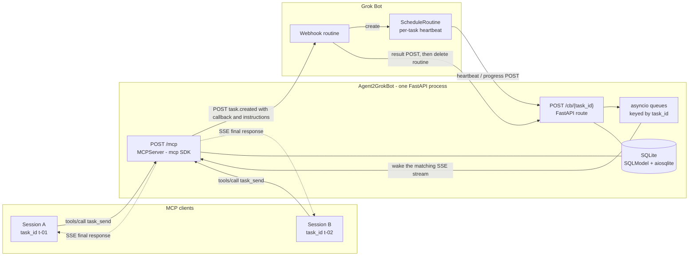
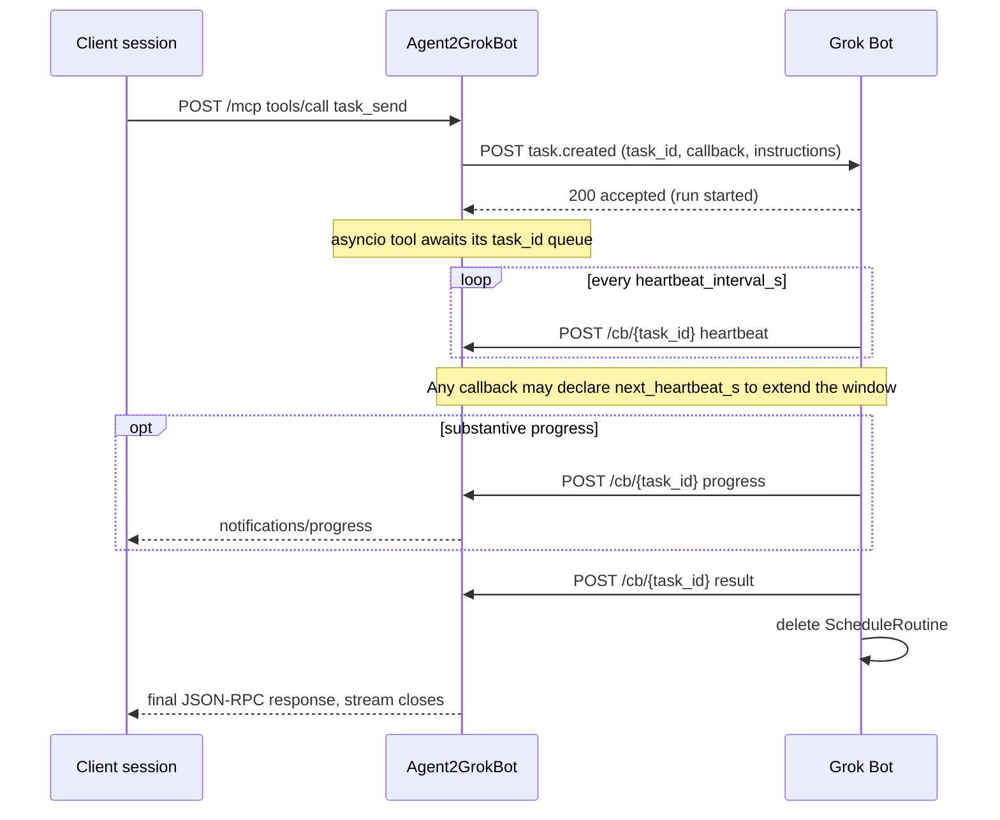

# Agent2GrokBot

An MCP server that lets any MCP client - Cursor Desktop, WorkBuddy or another
client - delegate work to a fixed, webhook-only Grok Bot peer and receive the
answer in the same tool call.

Desktop agents have no inbound listener, so a webhook reply has nowhere to land.
`Agent2GrokBot` sits on a real HTTP address and bridges the two halves: it holds
one SSE stream open for the client while the peer reports progress and results
by POSTing callbacks. When the HTTP deadline is reached, the call degrades to a
task handle that `task_get` can poll; the result is never lost.

Stack: Python 3.13, uv, FastAPI, the official `mcp` SDK (MCP 2.0 / 2026-07-28),
SQLModel over SQLite with aiosqlite. Versions are pinned in `pyproject.toml` and
`uv.lock`. There is no hand-rolled JSON-RPC, tool schema, SSE framing or keepalive.

## Architecture



`task_id` is the only routing key. Each in-flight `tools/call` owns one SSE
stream and one `asyncio.Queue`, so any number of client sessions can send tasks
to the same peer without cross-talk. `session_label` is audit metadata, never a
routing key.

The server talks to the peer by POST only. It never calls a routine API and never
inspects Grok Bot internals: `ScheduleRoutine` is requested by the `instructions`
text inside that POST, and the bot deletes it on completion.

The same exchange as a timeline:



## Quick start

```bash
git clone https://github.com/Anudorannador/Agent2GrokBot.git
cd Agent2GrokBot
uv sync                     # .python-version pins 3.13
uv run agent2grokbot        # 127.0.0.1:7583
```

1. **Run the server.** It binds `127.0.0.1` only. `GET /health` reports peer, lane,
   task and in-flight counts.

2. **Point an MCP client at it.** Any MCP client works; the entry below is the
   Cursor example, in `~/.cursor/mcp.json`, so restart Cursor after saving it:

   ```json
   {
     "mcpServers": {
       "agent2grokbot": {
         "url": "http://127.0.0.1:7583/mcp"
       }
     }
   }
   ```

   Do not hard-code `MCP-Protocol-Version`: the SDK detects the client revision
   from the request envelope or the legacy handshake, so both v2 and older
   clients get the right response shape.

3. **Set up the Grok Bot.** Paste
   [`grokbot/SETUP-PROMPT.md`](grokbot/SETUP-PROMPT.md) into the Bot chat once;
   it installs the standing behaviour for all webhook tasks. That init prompt
   defines the `X-A2G-*` headers, so re-paste it when migrating from an older
   deployment. Copy the routine's webhook URL and sender key from the routine
   panel, then register them:

   ```
   peer_add(name="Grok main", peer_id="grok-main", url="<webhook URL>", secret="<sender key>")
   ```

4. **Delegate.** The tool only runs when the agent is told to use it:

   > Delegate this with `task_send(peer_id="grok-main", prompt="...")`. If the
   > result says the task is still working, call `task_get` with that `task_id`.

For concurrent work, add more webhook triggers as lanes:

```
peer_update(peer_id="grok-main", add_lanes=[{"url": "...", "secret": "..."}])
```

The server allocates a free lane, queues when all lanes are busy, and releases
the lane on any terminal state. `task_cancel` POSTs an instruction telling the
peer to delete its ScheduleRoutine.

## Protocol

### Client to server (fixed by MCP)

Owned by the official `mcp` SDK. `POST /mcp` answers with `application/json` for
a quick result, or `200` + `text/event-stream` for a long one. The SDK emits
`notifications/progress` when the tool calls `Context.report_progress`, sends
`: ping` comment keepalives every 15 seconds, sets `X-Accel-Buffering: no`, and
terminates the stream with the final JSON-RPC response. Peer heartbeats count as
liveness only and are never forwarded to the model.

Modern clients send `Accept: application/json, text/event-stream` and put the
protocol version and client capabilities in `params._meta` on every request; the
SDK also accepts the legacy `initialize` handshake. This side is specified and
cannot be renegotiated.

### Server to peer (POST only)

The server sends one `task.created` POST containing `task_id`, `prompt`,
`callback` (URL, token, headers), `heartbeat_interval_s`, and `instructions`.
The peer returns `2xx` immediately and works in the background.

Every callback goes to `POST /cb/{task_id}` with:

- `type`: `heartbeat`, `progress`, `result`, or `failed`
- `event_id`: unique per callback, for idempotency
- `Bearer <callback_token>` and `X-A2G-Signature`: per-task credential plus
  HMAC over timestamp and raw body

Only an explicit `result` completes a task; silence is never completion. A
background sweeper marks a task `stale` after `A2G_MISS_THRESHOLD` times the
current liveness interval without a callback.

### Adaptive heartbeat timing

The peer owns its timer. A batch data-fix step can run far longer than the
initial `heartbeat_interval_s`, so any `heartbeat` or `progress` callback may
declare when it will check in next:

```json
{"type":"heartbeat","task_id":"t-01","event_id":"t-01-hb-4",
 "next_heartbeat_s":1800,"ts":1762400000}
```

| Input                | Where                                    | Meaning                     |
| -------------------- | ---------------------------------------- | --------------------------- |
| `next_heartbeat_s`   | JSON body or `X-A2G-Next-Heartbeat-S`    | Seconds from now            |
| `next_heartbeat_at`  | JSON body or `X-A2G-Next-Heartbeat-At`   | Absolute unix epoch seconds |

Body fields take precedence over headers, relative values over absolute ones.
The server stores the latest value on the task (clamped to 1..86400 seconds),
echoes it back as `next_heartbeat_s` in the `200` response, and uses it for
liveness. Invalid values are ignored, so a malformed hint never breaks a
callback; with no hint, the original `heartbeat_interval_s` stays in effect.
Declare a longer window before a long batch step, then shorten it again when the
work speeds up. A terminal `result` still ends the task.

### Long tasks

If `task_send` reaches `A2G_SSE_MAX_S`, it returns a normal
`resultType: "complete"` response containing a task handle; the agent then calls
`task_get`. The task keeps running in the background. SSE keepalives defeat
proxy idle timeouts, not a hard client deadline, which is why the handle exists.

## Tools

| Tool                                                                  | Purpose                                                                                              |
| --------------------------------------------------------------------- | ---------------------------------------------------------------------------------------------------- |
| `peer_add` / `peer_get` / `peer_list` / `peer_update` / `peer_delete` | Peer CRUD. Reads never return secrets, only a fingerprint. Delete refuses while tasks are in flight. |
| `task_send`                                                           | Dispatch and stream the result in one call. Accepts `session_label` and `heartbeat_interval_s`.     |
| `task_get` / `task_list`                                              | Read status and result, including after an SSE deadline.                                             |
| `task_cancel`                                                         | Cancel, notify the peer, release the lane.                                                           |

Tool schemas are generated from Python type hints by the SDK; `Context` is
injected for progress reporting and is not exposed in the schema.

## Configuration

| Variable                   | Default                   | Meaning                                                 |
| -------------------------- | ------------------------- | ------------------------------------------------------- |
| `A2G_DB`                   | `agent2grokbot.db`        | SQLite file (WAL)                                       |
| `A2G_PUBLIC_BASE_URL`      | `http://127.0.0.1:7583`   | Base for callback URLs and the allowed Host             |
| `A2G_ADMIN_TOKEN`          | empty                     | Bearer token required on `/mcp` when set                |
| `A2G_MASTER_SECRET`        | `agent2grokbot-local-dev` | HMAC key for per-task callback tokens                   |
| `A2G_HEARTBEAT_INTERVAL_S` | `300`                     | Initial interval; the peer may override it per callback |
| `A2G_MISS_THRESHOLD`       | `2`                       | Missed current intervals before `stale`                 |
| `A2G_SSE_MAX_S`            | `55`                      | Deadline before degrading to a task handle              |
| `A2G_ALLOW_PRIVATE_URLS`   | `1`                       | Set to `0` to block private webhook hosts (SSRF guard)  |

The `300s` interval and `2` misses match the five-minute floor of Grok Bot
scheduled watches. Lower them only when the peer heartbeats from its work loop.

Outbound POSTs carry `Authorization: Bearer <sender key>`, `X-A2G-Signature`
(HMAC-SHA256 over timestamp and raw body), `X-A2G-Delivery` and
`X-A2G-Task-Id`. Callbacks use a per-task token with the same signature
scheme, a 300-second replay window, and `(task_id, event_id)` deduplication.
Callbacks after a terminal state get `410`.

## Deployment and authentication

A remote MCP client and a public-internet Grok Bot both need a front end.
`A2G_PUBLIC_BASE_URL` must be that front end's URL: it builds `callback.url`
for the Bot **and** adds its Host to the SDK's DNS-rebinding allowlist. There is
exactly one extra allowed Host, so all clients must use the same hostname.

### Cloudflare Tunnel

```bash
# Terminal 1 - quick tunnel, copy the https://<name>.trycloudflare.com URL
cloudflared tunnel --url http://127.0.0.1:7583

# Terminal 2
A2G_PUBLIC_BASE_URL=https://<name>.trycloudflare.com \
A2G_ADMIN_TOKEN=<long-random-token> \
  uv run agent2grokbot
```

For a stable hostname, use a named tunnel with an ingress rule pointing
`a2g.example.com` at `http://127.0.0.1:7583`, then set
`A2G_PUBLIC_BASE_URL=https://a2g.example.com`. Cloudflare Access can sit in
front: give the client a service token via `CF-Access-Client-Id` and
`CF-Access-Client-Secret` headers, and add a bypass policy for `/cb/*`, or the
Grok Bot cannot POST its callbacks.

### Tailscale

```bash
# Private: tailnet members only, https://<machine>.<tailnet>.ts.net
tailscale serve https / http://127.0.0.1:7583

# Public: the same hostname opened to the internet, so Grok Bot can call back
tailscale funnel https / http://127.0.0.1:7583
tailscale funnel status
```

Funnel listens on 443 / 8443 / 10000 only and terminates TLS. Set
`A2G_PUBLIC_BASE_URL=https://<machine>.<tailnet>.ts.net`. **Serve alone does
not work here**: Grok Bot is not on the tailnet, so it cannot reach
`/cb/{task_id}` and every task would go `stale`. Serve injects
`Tailscale-User-Login` identity headers and honours tailnet grants; Funnel has
no built-in authentication at all.

### Credentials

| Path                             | Credential                                   | Notes                                                                                              |
| -------------------------------- | -------------------------------------------- | -------------------------------------------------------------------------------------------------- |
| `POST /mcp` (client)             | `Bearer <A2G_ADMIN_TOKEN>`                   | Only when the env var is set. No OAuth, no mTLS, no per-user identity.                             |
| `GET /health`                    | none                                         | Counts only, no secrets.                                                                            |
| `POST /cb/{task_id}` (Grok Bot)  | `Bearer <callback_token>` + HMAC signature   | Per-task token, 300s replay window, `event_id` dedupe, `410` after terminal. Not the admin token.  |
| `POST <webhook>` (Server to Bot) | `Bearer <lane secret>` + HMAC signature      | Lane secret registered by `peer_add`.                                                              |

`AdminTokenMiddleware` is pure ASGI and guards only `/mcp`, so it never buffers
the SSE stream. The SDK's DNS-rebinding check validates Host and Origin; it is
not authentication. TLS from cloudflared or Tailscale protects the transport,
but the application-level credential is still the Bearer token.

With a public front end, always set `A2G_ADMIN_TOKEN` and add
`"headers": {"Authorization": "Bearer <token>"}` to the `agent2grokbot` entry
in `~/.cursor/mcp.json`.

## Development

```bash
uv run python -m unittest discover -s tests -t . -v
uv build
uv lock --check
```

The suite is fully async (`IsolatedAsyncioTestCase`, `httpx.ASGITransport`, a
mocked webhook transport). It covers SDK-generated MCP 2.0 wire shapes and
version errors, the legacy handshake, peer CRUD, lane allocation and queueing,
callback auth and dedupe, adaptive heartbeats, stale detection, cancellation,
SSE progress frames, deadline degradation, and three concurrent sessions
sharing one peer.

## Limitations

- **The client does not wake itself.** This covers a reply arriving while a
  conversation is running, not waking the client from the background. That
  requires driving `cursor-agent --print` from an external watcher, which is
  the Cursor-specific example.
- **SSE keepalive defeats idle timeouts, not hard client deadlines.** The SDK
  pings every 15 seconds; `A2G_SSE_MAX_S` is a deployment value, and exceeding
  it degrades to `task_get` polling.
- **Single public host.** One extra DNS-rebinding Host, so a private tailnet
  hostname for the client and a separate public tunnel for callbacks cannot be
  mixed without changing the allowlist in `app.py`.
- **Single process.** Subscriber queues live in memory. A multi-replica
  deployment needs pub/sub so a callback can reach the instance holding the SSE
  stream.
- **No message eviction.** `agent2grokbot.db` grows indefinitely.
- **Peer liveness is threshold-based.** Only a refused connection at dispatch is
  detected instantly; a peer that dies mid-task is detected after missed
  heartbeats.

## License

MIT
